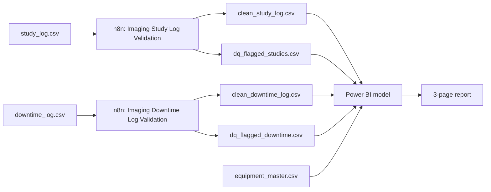
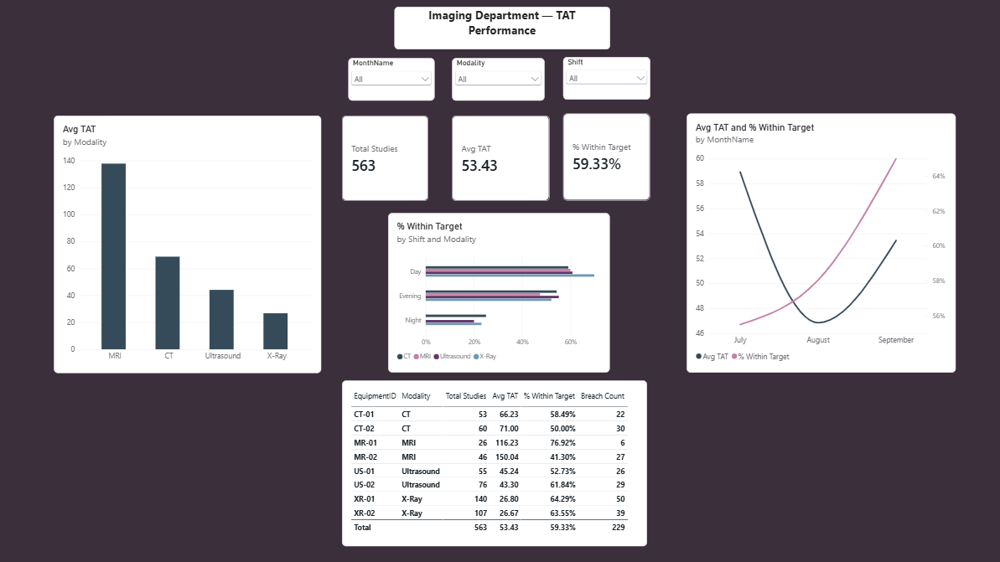
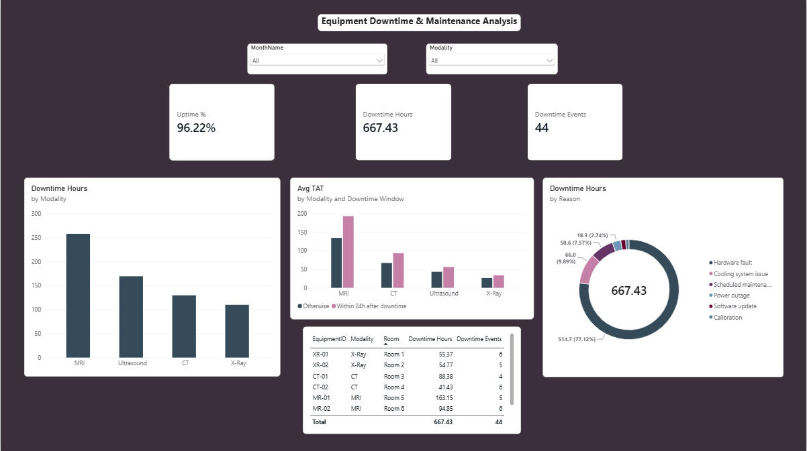
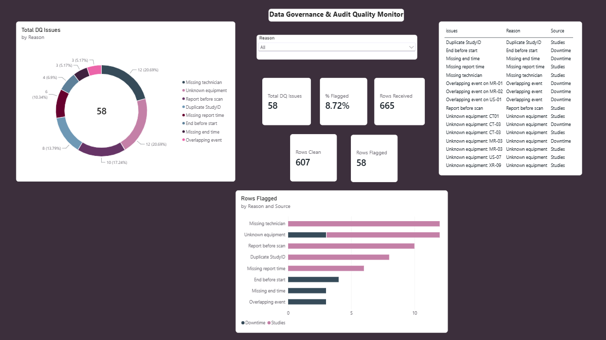
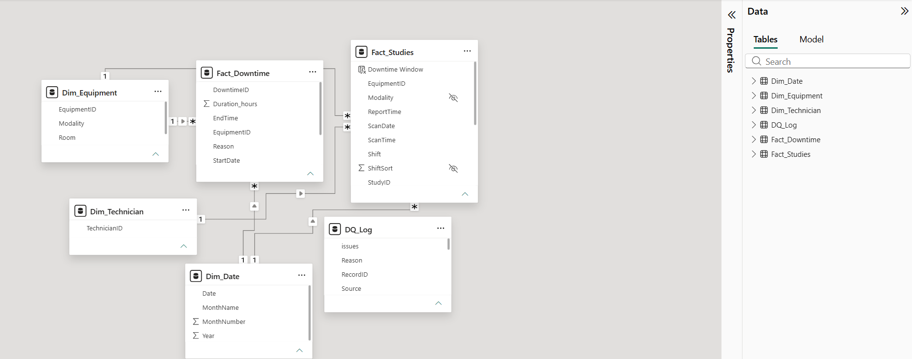
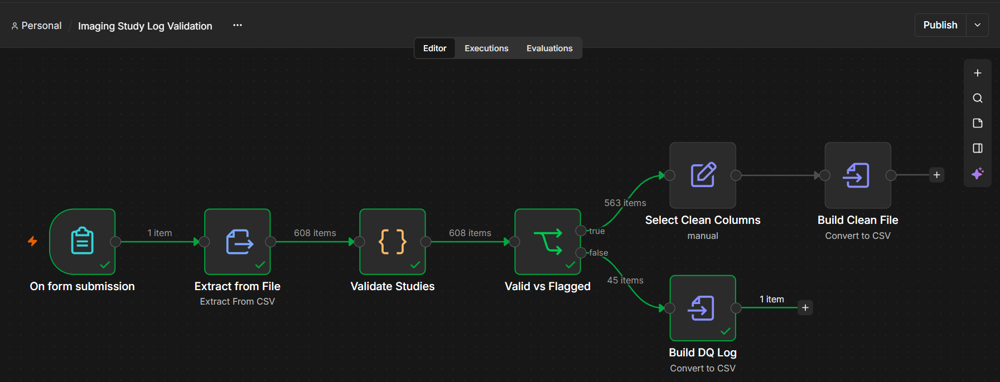
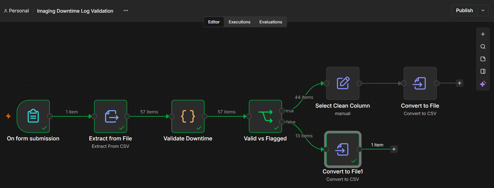

# Imaging Department Turnaround and Equipment Uptime Monitor (n8n + Power BI)

Two n8n workflows validate an imaging department's study log and equipment downtime log, split clean rows from flagged rows, and write a clean file plus an audit log for each. A three-page Power BI report then answers three questions: which modalities and shifts miss their turnaround targets, which machines lose the most hours (and what happens to turnaround afterwards), and how far the numbers can be trusted.

> **Scope note:** all data is **synthetic** (generated by `scripts/generate_datasets.py`, seed 2026). It contains no real patients, staff or hospital. Several patterns in it were built in deliberately, so the findings below show that the pipeline and dashboard recover them. They are not discoveries about a real department. Turnaround targets are my own illustrative values (see Assumptions).

Name: Soumit Ghosh Chaudhury 
LinkedIn: Soumit Ghosh Chaudhury
Email: soumitgc02@gmail.com

---

## Business questions

1. **TAT performance:** which modalities and shifts miss their turnaround targets?
2. **Downtime impact:** which machines lose the most hours, what is each machine's uptime, and does turnaround suffer after downtime?
3. **Data quality:** what came in, what was rejected and why, and does everything reconcile?

## Results at a glance

| | |
|---|---|
| Studies analysed | **563** clean (608 received, 45 flagged) |
| Downtime events analysed | **44** clean (57 received, 13 flagged) |
| Average turnaround (TAT) | **53.4 minutes** |
| Studies within target | **59.3%** (334 of 563), **229** breaches |
| Total downtime | **667.4 hours**, overall uptime **96.2%** |
| Rows flagged by the pipeline | **58 of 665** (8.7%) |

## Architecture



## Screenshots








## Data

| File | Rows | Contents |
|---|---|---|
| `equipment_master.csv` | 8 | two X-Ray, CT, MRI and Ultrasound units, with room |
| `study_log.csv` | 608 | StudyID, PatientRef, Modality, EquipmentID, TechnicianID, ScanTime, ReportTime |
| `downtime_log.csv` | 57 | DowntimeID, EquipmentID, StartTime, EndTime, Reason |

Planted problems (the full list, row by row, is in `docs/answer_key_details.csv`):

- **Study log:** 8 duplicate StudyIDs, 9 unknown equipment IDs, 12 missing technicians, 6 missing report times, 10 reports timed before the scan, 40 inconsistent modality names (for example `xray`, `USG`, `CT Scan`).
- **Downtime log:** 3 unknown equipment IDs, 3 missing end times, 4 end-before-start, 3 overlapping events on the same machine.
- **Both files:** three mixed timestamp formats (`YYYY-MM-DD HH:MM`, `DD/MM/YYYY HH:MM`, `MM-DD-YYYY HH:MM AM/PM`).

## n8n workflows

Both workflows follow the same pattern: form upload, Extract from File, a Code node that tags every row, an If node that splits valid from flagged, then two CSV outputs. Rows are **never deleted**: each flagged row carries the reason it failed.

**Study log** (code: `n8n/code/validate_studies.js`, mode: Run Once for All Items)

| Rule | Action |
|---|---|
| Duplicate StudyID (second and later occurrences) | flag |
| EquipmentID not in the equipment list | flag |
| Missing TechnicianID | flag |
| Missing ReportTime | flag |
| ReportTime earlier than ScanTime | flag |
| Modality name not standard | normalise to X-Ray, CT, MRI or Ultrasound |

The node also converts all timestamps to `YYYY-MM-DD HH:MM` and calculates `TAT_minutes`. Result: **608 in, 563 clean, 45 flagged** (8 + 9 + 12 + 6 + 10).

**Downtime log** (code: `n8n/code/validate_downtime.js`, mode: Run Once for All Items)

| Rule | Action |
|---|---|
| EquipmentID not in the equipment list | flag |
| Missing EndTime | flag |
| EndTime earlier than StartTime | flag |
| Event starts before the previous valid event on the same machine has ended | flag the later event |

The node also converts timestamps and calculates `Duration_hours`. Result: **57 in, 44 clean, 13 flagged** (3 + 3 + 4 + 3).

Both Code nodes run once for all items because duplicate and overlap detection compare a row with other rows. `n8n/code/run_summary_studies.js` and `run_summary_downtime.js` are optional one-line run reports.

## Power BI model

**Power Query:** timestamps set to Date/Time, `ScanDate` and `StartDate` added, `Shift` derived from the scan hour (Day 07:00 to 14:59, Evening 15:00 to 22:59, Night 23:00 to 06:59) with a sort column, `PatientRef` removed (no measure needs it), a `Dim_Technician` built from distinct IDs, a small `Target` table merged into `Dim_Equipment`, and the two DQ logs appended into one `DQ_Log` with a cleaned `Reason` column. The date table is built from the data's own minimum and maximum dates (92 days) and not from fixed dates.

**Model:** a star schema with two fact tables, `Fact_Studies` and `Fact_Downtime`, sharing `Dim_Equipment` and `Dim_Date`; `Dim_Technician` relates to studies. `DQ_Log` is deliberately disconnected and only feeds the data quality page.

| Measure | Meaning |
|---|---|
| Total Studies, Avg TAT | count of studies, average TAT in minutes |
| % Within Target, Breach Count | studies with TAT at or below their modality's target, and the rest |
| Downtime Hours, Downtime Events | sum of duration, count of events |
| Machines, Days in Period, Available Hours | units in the current filter, days in the current filter, machines x days x 24 |
| Uptime % | 1 minus downtime hours divided by available hours |
| Downtime Window (column) | labels a study "Within 24h after downtime" if its machine's downtime ended up to 24 hours earlier |
| Rows Clean, Rows Flagged, Rows Received, % Flagged | reconciliation between the pipeline and the model, also split by source |

## Findings

All figures are measured on the 563 clean studies and 44 clean downtime events.

**Turnaround**
- Average TAT by modality: X-Ray **26.7**, Ultrasound **44.1**, CT **68.8**, MRI **137.8** minutes.
- Night-shift studies take longer: average **80.8** minutes against **48.7** for Day. The same holds within each modality (for example X-Ray 38.8 vs 25.3, CT 100.9 vs 62.6). Only 33 studies are night-shift, and just 3 are MRI at night, so treat the size of the effect with caution.
- MR-02 is slower than MR-01: **150.0** vs **116.2** minutes.

**Downtime**
- 44 events, **667.4 hours** in total. **Hardware faults account for 514.7 hours (77%)**.
- MR-01 (163.2 h) and US-01 (140.3 h) lose the most time. Lowest uptime: MR-01 **92.6%**, US-01 **93.6%**. Highest: US-02 **98.7%**.
- Studies scanned within 24 hours after a downtime event ended on the same machine took longer in every modality: X-Ray 33.7 vs 26.3, Ultrasound 56.1 vs 43.2, CT 93.4 vs 67.1, MRI 193.5 vs 134.6 minutes. Only **34 studies** fall in that window (4 for MRI), so this is an indication and not proof.

**Data quality**
- 58 of 665 rows (8.7%) were flagged. The largest reasons are missing technician (12) and unknown equipment (12, of which 9 are studies and 3 are downtime).

## Reconciliation

| | Studies | Downtime | Total |
|---|---|---|---|
| Received by n8n | 608 | 57 | 665 |
| Clean (in Power BI) | 563 | 44 | 607 |
| Flagged (in `DQ_Log`) | 45 | 13 | 58 |

Clean plus flagged equals received for both logs. The Power BI report shows the same totals, and the flagged counts by reason match the answer key.

## Testing and lessons learned

- **Independent answer key.** Before trusting either workflow, I recomputed the expected counts for every rule with a separate script, and the n8n output matched on every count.
- **Wrong field in the clean file.** My first clean study file had the right rows but held the original messy dates under the cleaned column's name, because I had mapped the wrong field in the Edit Fields node. I caught it by comparing rows with month-first dates against the source, and fixed the mapping.
- **Excel and Power BI change how dates look.** The files store ISO text (`2026-07-13 05:11`). Excel and Power BI display real dates in the computer's regional format (day-first on my machine), so correct data can look wrong. I verified the output in a plain text editor.
- **Date table covering a full year.** My first date table spanned 365 days, which would have inflated available hours and uptime. I rebuilt its range from the data (92 days) and checked the Days in Period card.
- **A calculated column in the wrong table** failed with "a single value cannot be determined". I recreated it on `Fact_Studies`, and the "after downtime" group came to the expected 34 studies.
- **Targets set too low.** My first targets passed only 12% of studies, so almost everything was a breach. I reset them near each modality's average.
- **Disconnected tables.** A chart of data quality issues by technician repeated the grand total for every technician, because `DQ_Log` is not related to `Dim_Technician`. I removed it.

## Assumptions and design decisions

- **Targets are illustrative.** X-Ray 30, Ultrasound 45, CT 70, MRI 140 minutes, set near each modality's average on this synthetic data. They are not clinical or accreditation benchmarks and would be replaced with the department's real targets.
- **Tag, don't delete.** Rejected rows go to an audit file with a reason, so nothing is silently lost.
- **Date convention.** Slashes are read as day first and dashes with the year last as month first, matching how this dataset was built. A real file would not tell you, so I would confirm it with the data owner.
- **A downtime event belongs to the month it starts in,** even if it runs into the next one.
- **Flagged rows are excluded** from the analysis pages and shown on the data quality page.
- **The valid equipment list is hardcoded** in the n8n code, and `PatientRef` is dropped in Power BI.
- **Monthly chart on the TAT page.** It plots Avg TAT and % Within Target on separate axes that do not start at zero, so month-to-month changes look larger than they are. Avg TAT moves from 58.9 to 46.8 to 53.4 minutes and % within target from 55.5% to 58.0% to 65.0%, which is about 12 minutes and 10 percentage points across three months. Read it as direction only, since three months of synthetic data show no real trend.

## What I would change for production

- Put authentication on the upload forms, since real imaging and patient data is sensitive.
- Check equipment IDs against the equipment master table instead of a hardcoded list.
- Replace the manual upload with a schedule and a data source (a database or an API with stored credentials), and send an alert when the flagged share jumps.
- Write the audit logs to a database or sheet, add retries and error handling, and handle large files in batches.
- Apply proper data governance for patient data: access control, retention and de-identification.

## Repository structure

```
.
├── README.md
├── data/                      # equipment_master.csv, study_log.csv, downtime_log.csv
├── docs/                      # answer_key.md, answer_key_details.csv
├── scripts/                   # generate_datasets.py, verify_answer_key.py
├── n8n/
│   ├── imaging_study_log_validation.json
│   ├── imaging_downtime_log_validation.json
│   └── code/                  # validate_studies.js, validate_downtime.js, run_summary_*.js
├── outputs/                   # clean_study_log.csv, clean_downtime_log.csv, dq_flagged_studies.csv, dq_flagged_downtime.csv
├── powerbi/
│   └── imaging-tat-uptime-monitor.pbix
├── report/
│   └── imaging-tat-uptime-monitor.pdf
└── screenshots/
```

## How to run it

1. Use an n8n Cloud free trial or a self-hosted n8n, and import both workflow files from `n8n/`.
2. In each workflow, run the form's Test URL and upload the matching file from `data/`.
3. Download the clean and DQ files from the CSV nodes (the Binary tab). Expect 563 and 45 rows for the study log, and 44 and 13 for the downtime log.
4. Open the `.pbix` and point the data sources at your downloaded files (**Transform data → Data source settings**).
5. To regenerate the data: `python scripts/generate_datasets.py`. To verify it: `python scripts/verify_answer_key.py` (prints MATCH).

## Tools

n8n (Cloud trial), JavaScript (Code nodes), Power BI Desktop (Power Query, DAX), Python (dataset generation and verification), CSV.